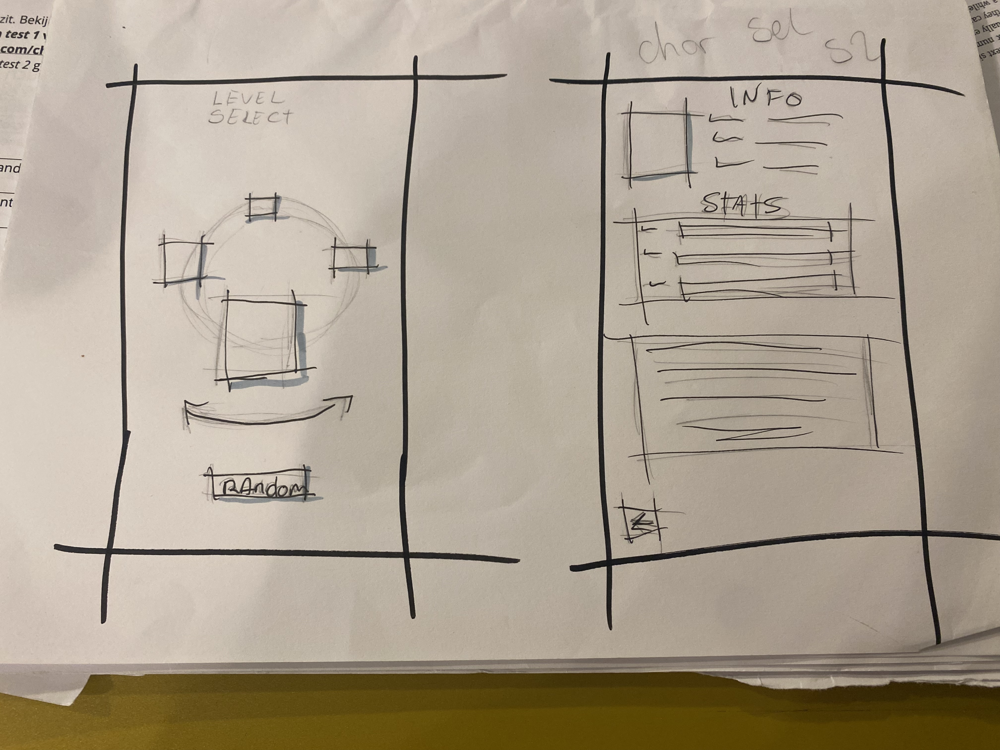
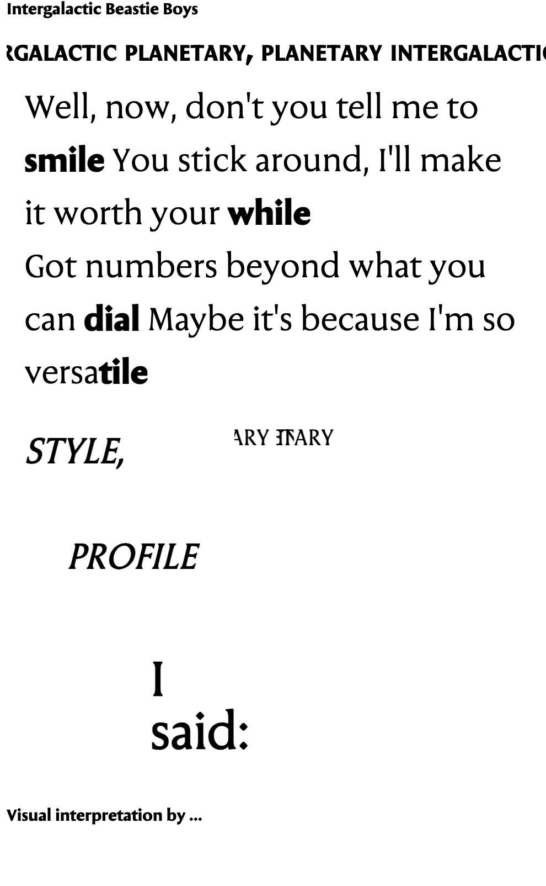
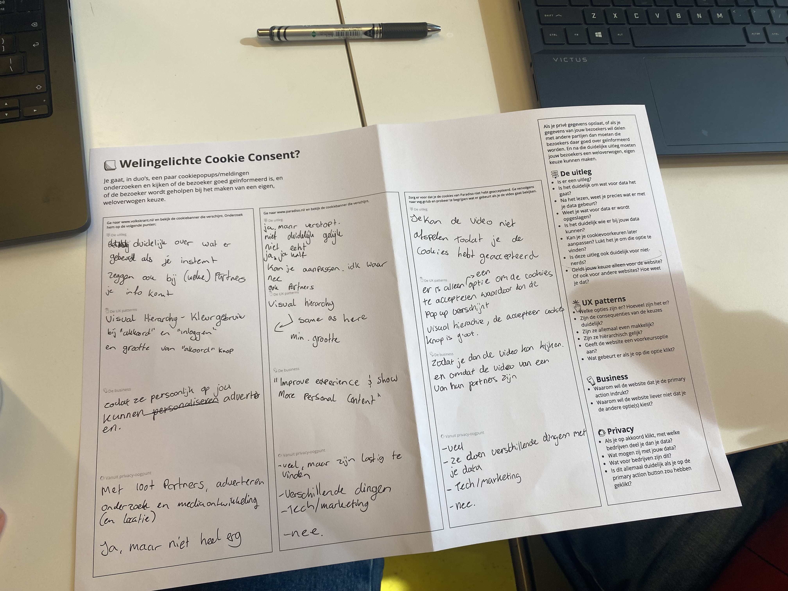

# Model

Het staat model voor digitale tuintjes welke bij 'Het web is voor iedereen' door studenten worden gemaakt.

## Learning Log

### 24/25 okt - last details voor de deadline!

dingen die ik heb aangepast:

- font van de HCN aangepast naar Tahoma, zodat de vormgeving aansluit bij het feit dat dit over privacy info gaat
- wording van de HCN aangepast zodat het niet zo vaag is.
- caps locked tekst UIT de HTML gehaald en via CSS in caps gezet.
- eindelijk mijn schetsen en retrospectives in mijn learning log gezet.
- bezig geweest met mijn lyric experiment. (zeker nog niet af...)

ALS IK MEER TIJD HAD GEHAD:

- de contact knop ook onklikbaar maken bij rejection. Het is een gimmick die niet echt nut heeft op deze site (Het is meer iets wat ik wou uitproberen en dit was in mijn hoofd een goede plek om het te doen.)
- Lyrics volledig uitwerken. Ik heb het experiment heel erg abandoned omdat ik zo gestressed was over mijn site. Ik heb hier best spijt van en had ook zeker dit beter willen uitwerken
- de logical properties goed noteren. Dit kwam in mijn feedback naarboven, ik heb een mix van de properties i.p.v. met 1tje aan de slag te gaan. De volgende keer ga ik ook goed opletten dat ik ze niet mix!
- Screenreader tweaks. In mijn cookie dialog is de accepteer knop gelijk gefocussed. Als ik nog tijd over had, wou ik ook zeker kijken naar hoe ik de tekst kon laten focussen i.p.v. de buttons.

### al mijn schetsen (ik was ze steeds vergeten in te voegen...)

### 23 okt - feedback en retrospective

### 22 okt - laatste loodjes in de bieb

om echt goed de focus te kunnen pakken (en niet afgeleid te worden door games/vrienden/de buitenwereld) heb ik besloten om vandaag in de bieb te werken! een duidelijke to do list voor mijzelf gemaakt en een stille plek opgezocht waar ik echt even kan knallen!

Later op de avond had ik nog een teamuitje, waar ik mijn laptop mee naartoe heb genomen om toch nog ff aan de slag te kunnen!

dingen die ik nog moet/wil fixen:

- als je van gedachten veranderd over cookies, dat als je toch nee klikt de link weer onklikbaar wordt. (bij toch wel cookies accepteren na geen consent te geven wordt de link wel klikbaar, maar andersom niet...)

- favicon maken voor de site....

- schetsen toevoegen in de readme.... ik blijf het vergeten...

### 21 okt - bi-weekly geek

### 19 okt - Maandag

feedback van Poema -

- Quest pagina is leuk!
- meer afbeeldingen die bij thema passen invoegen
- Lettertype van paragraaf in inventory nog 1x bekijken

### 9 okt - Laatste dag voor herfstreces

Ik ben duidelijk toe aan vakantie, ik had de lyrics donderdag uitgewerkt op mijn desktop maar was helemaal vergeten het weer naar mn laptop te sturen... Dus de feedback vandaag ging over waar ik woensdag mee geeindigd was ipv wat ik daadwerlijk af had donderdag...
[PC VERSIE]
Feeback over songtekst opdracht:

- intro lijkt nu brick wall, is dat de bedoeling? (goed idee: ticker tape! gelijk mee begonnen!!!)
- Let op witruimte en grootte van woorden
- Intonatie laten zien zonder de woorden te veel ruimte in te laten nemen

CHECKOUT:
Welke variabelen van Seraphs gebruik je in de opmaak van je songtekst?

- Ik gebruik verschillende door de songtekst heen, maar voor het grootste deel gebruik ik:
  "wght" 110,
  "SRFS" 5;

Wat voegt iedere variabele toe aan je ontwerp (denk aan leesbaarheid, hiërarchie of de uitstraling die je wil bereiken)?

- Bij mij voegt het hierarchie toe, maar ook laat het de woorden die luider gezongen/gerapt worden van de pagina springen

Hoe zou je animatie kunnen toepassen om het ritme of de accenten in de weergave van je songtekst nog beter visueel te maken?

- door de tekst te laten schudden of wavy te maken kan je duidelijk maken hoe de artiest de lyrics aan het zingen/rappen/zeggen is.

### 7 okt - Lyrics

Waarom is het goed om een grid in je ontwerp toe te passen? Noem een reden voor de ontwerper en een voor de bezoeker.

- antwoord
  een grid kan een ontwerper helpen met elementen heel precies te plaatsen. Voor een bezoeker zijn grids fijn omdat ze voor een duidelijke structuur/hierarchie op een pagina zorgen

Noem drie manieren om chaos in je ontwerp te voorkomen.

- antwoord

1. grids gebruiken
2. niet te veel kleuren gebruiken/een vast kleurschema gebruiken
3. goed gebruik van witruimte

Hoeveel gekkigheid moet er in je werk zitten?

- zo veel als jouw idee ondersteunt, maar niet zo veel dat het jouw werk onlees- of onbruikbaar maakt.

  

### 5 okt - Start sprint 3

[TEKST SCHRIJVEN OVER VANDAAG]

CHECKOUT:

1. Leg uit wat er met de volgende termen bedoeld wordt: kerning, tracking, leading, flush-left, flush-right, centered, justified, indent, outdent, modular scale, movable type, focus punt, vijf soorten contrast, spatial tension.

Kerning

- Kerning past kleine spaties tussen tekens aan
  en corrigeert slecht passende paren die afleiden door
  botsingen of spaties.
  Tracking
- Leading
  de verticale afstand van de ene basislijn naar de volgende, gemeten in punten.
- Flush-left/Flush-right
  tekst die uitgelijnd is met de linker/rechter kant. Flush-left is het meest voorkomend en het fijnst om te lezen omdat het de natuurlijke leesbeweging stimuleert. Flush-right contrasteerd goed met flush-left en is goed voor lines en woorden.
- Centered
  Gecentreerde uitlijning van tekst. Nuttig in beperkte omgevingen met minimale tekst, zoals titelpagina's van boeken. Het wordt niet vaak gebruikt voor doorlopende stukken tekst zoals alinea's
- Justified
  De breedte van de woordafstand is afhankelijk van de lettergrootte, de regellengte en het aantal tekens per regel.
- Indent/Outdent
  Beweging van een stuk tekst (naar binnen of naar buiten) om hierarchie aan te tonen of een lijst duidelijk te maken
- Modular scale
- Een manier van lettergroottes scalen op basis van ratio's (golden ratio, perfect fifths etc). Hierdoor blijven de verschillende headings etc in harmonie.
- Movable type
  Een printsysteem dat gebruikmaakt van herbruikbare onderdelen voor elk teken of elke letter.
- Focus punt
  De plek waar je ogen automatisch als eerste naartoe worden getrokken wanneer je ergens naar kijkt.
- Vijf soorten contrast
  Kleur, Grootte, ruimte, gewicht en vorm.
- Spatial tension
  Een manier om je design dynamischer te maken.
  Je kunt op veel manieren spatial tension creëren.
  Zes methoden zijn: het midden vermijden, een richting vormgeven, ongelijke vormen/randen creëren, contrast creëren tussen de groottes van witte vormen, rekening houden met de z-as en rekening houden met de randen.

2. Wat is jouw ideale regellengte (measure)? Leg uit waarom.

Mijn ideale regellengte is tussen de 50 en 60, anders wordt het echt te druk voor mijn ogen om op de letters te kunnen focussen.

3. Als je in een ontwerp maar één variabele tot je beschikking had om hiërarchie aan te brengen (grootte, plaatsing, spacing, lettersoorten), welke zou je dan gebruiken en waarom?

Ik zou voor lettersoorten kiezen. Met de andere opties valt wel te spelen, maar niet op de schaal dat je met lettersoorten kan spelen.

### 2 okt - feedback en retrospective

notities feedback:

- deepdives als 1e bron pakken, geen eigen workarounds bedenken/gebruiken maar aangereikte stof zo veel mogelijk gebruiken.
- HTML in schets helpt veel met al nadenken hoe iets vormgegeven kan worden.
- Human concent notice uitwerken.
- fieldset vervangen door andere optie.
- Bronnen verzamelen en als comments bij de code zetten waar ze zijn gebruikt.
- elements uit script halen en andere namen geven (a en i)
- apart JS bestand aanmaken, is cleaner.

### 30 sept - Testing

Ik heb in de les samen met Susanne getest! Hieruit kwam dat mijn site best toegankelijk is!
Er kwamen 2 dingen uit die ik nog moest aanpassen (contrast van de cookies button en reduced motion (...die ik had, maar perongeluk heb verwijderd))
De cookies button heb ik gelijk aangepast en was hierdoor ook een stuk beter (zie images below)

before

en after!

CHECKOUT:

Waar staat WCAG en A11y voor?

WCAG - Web Content Accessibility Guidelines
Internationale standaarden voor digitale toegankelijkheid.

A11y - Afkorting voor Accessibility

Wat vind je lastiger, je laptop/websites alleen met een toetsenbord bedienen of met een screenreader? Waarom? Waar moet je nog mee oefenen?
Ik gebruik zelf af en toe al de screenreader (zonder bril ben ik namelijk heel slechtziend), maar ik merk wel dat ik nog echt de shortcuts beter kan leren. De basic controls om een site door te komen ken ik, maar de details moet ik mij nog even in verdiepen.

Met welke beperking rekening houden vind je het meest lastig?
Ik denk Complete blindheid. Ik merk dat ik nog best struggle met alles compatible maken voor een screenreader!! Dus dat is zeker iets waar ik nog mee aan de slag moet!

Vind je dat je beperkt wordt in wat je kunt ontwerpen?
Nee, want er zijn genoeg opties om een site toch 'mooi' te maken voor iedereen die de site kan bekijken (of beluisteren haha)

Of heb je al manieren gevonden om vanuit een solide basis - die voor iedereen toegankelijk is - allemaal leuke en mooie extra's toe te voegen als je bezoekers dat goed vinden?

Ik heb nog niet bewust naar dit soort dingen gekeken, maar het kan zeker zijn dat ik ze onbeuwust al heb verwerkt!!

### 29 sept - weer aan de slag

excuseer mijn taalgebruik, maar holy fuck wat ben ik blij dat ik beter ben. Na echt goed uit te zieken ben ik vandaag weer aan de slag gegaan.
Terwijl ik ziek was, heb ik hard nagedacht over wat ik nou echt wou laten zien in mijn garden. Mijn originele idee was leuk maar liet niet echt mijn thema zien, dus heb ik besloten om from scratch te beginnen en ben gaan schetsen (zie schetsen bovenaan dit bestand).

Op basis van mijn schetsen ben ik gaan denken hoe ik dit ga vormgeven in code en welke elementen ik ga gebruiken.
Toen ik langer dan 5 minuten naar een scherm kon kijken, ben ik begonnen met coderen in VSCode zodat ik hier mijn progress niet kwijt zou raken als ik besloot toch terug te gaan naar mijn oude idee.
Wanneer ik vastliep ben ik naar de MDN gegaan om te kijken hoe ik door kon en welke elementen ik kan gebruiken.

Uiteindelijk is mijn idee heel simpel geworden, maar het laat wel duidelijk de vibe zien die ik in gedachten had!!
Het is zeker nog niet waar ik het wil hebben, maar ik ben al blij met wat er nu staat.

Ik loop nog zeker achter qua huiswerk en de deep dives, maar ik geloof in mijzelf dat ik dit kan bijpakken en dat ik een goede inhaalslag kan maken!!

### 23 sept - toch nog ziek...

na een weekend uit te zieken dacht ik de 21e weer beter te zijn, helaas werd ik toch weer ziek wakker op de 22e :(. Ik heb dus besloten om mijn gezondheid op 1 te zetten en thuis te blijven om echt helemaal uit te zieken. Waar mogelijk (op schermen kijken blijkt best misselijkmakend te zijn op dit moment...) probeer ik bij te blijven met huiswerk/code/opdrachten en houd ik contact met klasgenoten over wat ik mis!

### 21 sept - start sprint 2

COOKIE OPDRACHT:
Weet jij waarmee je precies akkoord gaat als je op “accepteren” klikt?

CHECKOUT
Wat zijn HTML landmark role elements?

Dat zijn onderdelen van een webpagina/code die aangeven waar belangrijke secties zich bevinden, zodat mensen met schermlezers en toetsenbordgebruikers zich makkelijk over de pagina kunnen navigeren.

Wat zijn heading elementen en hoe horen deze 'genest' te worden?

Heading elementen zijn tags die gebruikt worden om structuur en hierarchie te bepalen in een HTML bestand.
Ze horen op volgorde van 1 naar 6 genest te worden, dus zonder niveaus over te slaan.

Hoe ga jij met cookies om? Beschrijf jouw beweegredenen en of die zijn veranderd na het volgen van dit college.

Ikzelf lees altijd snel de cookie popup door om te kijken hoe vaag het geschreven is (en ook omdat ik best nieuwsgierig ben haha), ik wijs ze eigenlijk altijd af, tenzij het niet mogelijk is omdat je "neccessary" cookies moet accepteren. Mijn beweegredenen zijn vooral het feit dat ik niet graag getracked wordt en het mij ook niet echt boeit of ik 'persoonlijke' advertenties te zien krijg.
Voor mij zijn hoe ik met cookies om ga en mijn beweegredenen niet veranderd na het volgen van dit college.

### 18 sept - weer aan de slag na goed ziek zijn.

Ik ben een volledige week echt goed ziek geweest, ik kon niet naar een scherm kijken. Dus heb een week niet aan school kunnen zitten helaas. Hier baal ik echt heel erg van want ik had zo veel willen doen wat gewoon niet lukte.
Ik ben veels te vroeg opgestaan op de 18e om mijn idee uit te werken in HTML, het is heel bare-bones. maar ik kan hier wel mee verder werken.
De deep dives en lessen die ik heb gemist ga ik ook zeker nog inhalen, want ik wil zo veel mogelijk uit dit blok halen en een week ziek zijn gaat mij niet tegenhouden!!!

Ik heb van 4:30 tot 6:20 aan mijn code gezeten om iets te kunnen laten zien. (hevige shoutout naar MDN en een van mn online vrienden voor de hulp als ik iets niet begreep.) Ik ben er nog niet tevreden mee, maar heb nog niet de energie om in-depth te werken.

### 9 sept - online les (OV staking)

ik heb de presentatie gedaan met Katey Brinckman

vragenlijst van DLO:
wat is voor jou de essentie van wat je hebt gepresenteerd qua onderwerp en geschreven/beeldende content.
-de essentie van mijn presentatie was het nostalgische gevoel van retro games

welke woorden uit de kwaliteitenlijt kunnen passen bij je onderwerp?
-wij hebben geen kwaliteitenlijst behandeld in de les...

heeft 'de ander' een aanvulling op je onderwerp?
-je zou ergens een animatie kunnen maken dat het lijkt dat je in een game zit (bijv. flappy bird die door de pipes gaat of mario die rent.)

Wat is het karakter/de uitstraling/het gevoel dat bij het onderwerp past?
-retro,nostalgie,game-y,nerdy.

-welke inspiratie kun je uit je 25 (??? het moesten er toch 50 zijn????) afbeeldingen halen. stijl, een gevoel, vorm, enz.
-Retro game stijl, nostalgisch gevoel.

extra vragen van Katey:

Ga je echt de games op de sites zetten of alleen de vibes nabootsen?
-mijn plan is om de vibes na te bootsen maar op sommige plekken ook kleine elementen van de games te gebruiken, waardoor dit echt een interactieve ervaring wordt.

PRESENTATIE:

### 8 sept - thuis aan de slag

Vandaag was ik bezig geweest met de presentatie voor woensdag maken met remark.
Ik wou zo veel mogelijk de markdown gebruiken en zo min mogelijk HTML, maar dat bleek onmogelijk aangezien de markdown niet werkte hoe het hoorde.
Ik heb de hele wiki doorgelezen en ben forums afgegaan om te kijken waarom niets mij lukte. Helaas kwam hier niets uit want ik had alles correct gedaan.

ik heb hierdoor mijn presentatie heel minimalistisch genhouden en helaas niet kunnen doen hoe ik wil T^T

Ik heb de deep dive voor light & dark mode doorgenomen

### 7 sept - Checkout

VRAAG: Leg uit wat een digital garden is en waarom dat anders is dan een reguliere website.
ANTWOORD: Een digital garden is een soort 'speeltuin' site, waar je je gedachtes en ideeen kan posten en constant kan blijven aanvullen of aanpassen. Je kan het vormgeven hoe je het wilt en plaatsen wat je maar wilt. Dit is anders dan een reguliere website want het hoeft niet te voldoen aan de 'normen' van reguliere sites. ook de opmaak en opbouw van een digital garden verschilt heel erg van een reguliere website.

VRAAG: Leg uit wat een website 'webby' maakt en welke websites jou het meeste inspireren.
ANTWOORD: een website is 'webby' wanneer het voldoet aan de volgende punten:
fluide/adaptief, interactief/dynamisch, toegankelijk, volwassen, expressief, leuk/verrassend.
sites die mij inspireren zijn bijvoorbeeld: tumblr.com, academiaaesthetics.com en na de les van vandaag ook melonland.net

VRAAG: Vertel waar jij mee aan de slag wilt gaan bij het maken van jouw eigen digital garden (let op: dit zijn jouw eerste ideeën, dit kan en mag veranderen in de loop van het programma.)
ANTWOORD: ik zit op dit moment nog te twijfelen tussen iets 'mystics' (denk tarot etc), iets weirdcore/silly, of iets game-y. Beide topics interesseren mij heel erg, maar ik zou nu nog niet weten hoe ik er mee verder ga. Dinsdag ga ik research doen en dan ook een besluit maken met waar ik mee aan de slag wil gaan.

Er werdt vertelt dat wij met een projectboard kunnen werken op github, ik ben dit gewend om te doen op trello. Op github laadde de projectboard niet dus ben ik begonnen met mijn projectboard op trello in te vullen.

### 4 sept - [Workshop]

notities van de deep dives waar ik aanwezig bij was:

DEEP DIVE 1 - TYPOGRAFIE

voorbereiding notities:

type-together notes:
-> needs of typeface decide the form of the characters
-> having just a few typefaces is always better than using too many
-> the type of reading media (research, books, etc) is also an important factor
-> does the font contain glyphs/special chatacters needed to produce the work?
-> be careful when using 'trendy' fonts, they can quickly make a site look outdated when the trend passes.

arielsalminen notes:
-> old GUI were essentially just text
-> good writing = good design
-> good copywriting & typography make up 95% of interface design
-> identification of individual letters plays the most critical part in the reading process
-> an ideal UI typeface doesn't scream for attention.

Tijdens de les zaten we maar met 4 mensen, dus het was een hele fijne deep dive om veel info te krijgen.

-> keep track of wat je blijft prikkelen/wat je tof vindt.
hoe kies je een passend lettertype?
-> stijl
->leesbaarheid
-> opties
->beschikbaarheid

we hebben een opdracht gedaan om een (volgends ons) passend font bij 1 van 2 stijlen van Dolly Parton te kiezen
hierbij hadden we een foto van Dolly in een country outfit en eentje in een meer Hollywood glamour outfit.

ik had de volgende keywords bij de fotos :
foto 1:
-country
-Round
-zacht
-lief
-upbeat
-darling
-sweetheart
-yeehaw
-texas
-curvy

foto 2:
-glamour
-hollywood
-diva
-strak
-silver
-sparkles
-curvy

ik koos om met de country foto te werken en met de volgende key words:
-Darling
->honey
->sweet
->baby
->kind
->lovely

-Upbeat
->helpful
->happy
->sweet
->extrovert
->positive

-zacht
->voorzichtig
->cotton
->lief
->aardig
->wolken

ik heb de 3 woorden: honey, happy en lief gekozen om een font mee te zoeken. hierbij ben ik terecht gekomen bij het font 'good karma'

DEEP DIVE 2 - SCHETSEN

uitganspunten van een goede schets:
-> idee komt duidelijk over voor 'newbies'
-> annotaties in andere kleur en in blokletters
-> goede verhoudingen in vergelijking met het echte/eind product
-> consistentie in personages (als die worden gebruikt.)
-> content vormgeven

slechte schets:
-> geen annotaties
-> onduidelijk wat het idee is
-> formaat wisselt door heel schets heen.

### 2 sept - [Workshop]

notities van de deep dives waar ik aanwezig bij was:

DEEP DIVE 1 - HTML & CSS BASICS

Vraag: Met cascades, is er een voorkeur nu voor een specifiek soort stylesheet?
Antwoord: Normaal gesproken ligt het aan hoe je de sheet koppelt aan de pagina.
Inline wordt gezien als een bad practice, maar is wel het meest krachtigst.
In Head is handig voor one pagers, omdat het maar 1 request hoeft te sturen.
Het is, however wel een bad practice bij meerdere pages.
Voor nu is de voorkeur voor een external stylesheet zoals bijgeleverd in de model.

Vraag: Kan je em en strong gebruiken wanneer je wilt, of is het sparend net als bij br?
Antwoord: Er was geen tijd meer om mijn tweede vraag te stellen, deze heb ik geparkeerd voor vrijdag en zal dan ook deze learning log aanpassen met het antwoord er op

Ik heb voor de rest geen notities gemaakt, dit was voor mij meer een refresher van de kennis die al ik heb dan echt een deep dive.

mozilla 'verwondert':

audio en video: ik weet er al wat vanaf maar wil er graag meer over leren.

DEEP DIVE 2 - CSS: FONTS MET KLEUR EN EFFECTEN

De voorbereiding hiervoor ging lastig, aangezien ik niet de codepen kon forken met mijn free account. Ik heb wel naar de code gekeken als voorbereiding en aangegeven toen ik de les in kwam dat forken niet mogelijk was.

We hebben bestanden toegestuurd gekregen in teams waardoor we nu wel de opdrachten kunnen uitvoeren.

Voor opdracht 3 heb ik gekozen om de 'MYST' en 'CHESS' uitdagingen uit te werken.

Notities tijdens deep dive:
-> persoonlijke huisstijl creëren.
Geen fontdiensten gebruiken (i.e. Google fonts, Adobe fonts.) I.v.m. privacywetten.
-> fonts er van downloaden kan wel!

@font-face BOVEN IN DE CODE
-> naam geven in "" met 'font-family'
->linken met 'src:url("../fonts/FONTNAAM.ttf");'

Met meerdere diktes van een font:
-> nog een @font-face declaratie met dezelfde 'font-family' naam
-> 'font-weight' aangeven met de correcte weight/dikte van font.
-> voor italic: 'font-style: italic'

### 31 aug - Kickoff

Een fork van de model repository gemaakt en gepubliceerd via mijn eigen Github omgeving.

checkout vragen:
1 Leg uit wat een source hosting platform is en voor welke jij gekozen hebt.
-> Een source hosting platform is een online opslag en samenwerkings omgeving voor broncode van websites en software. Ik heb hierbij gekozen voor Github omdat ik hier vorig schooljaar ook mee heb gewerkt en dit dus al gewend ben.

2 Vertel welke domeinnaam jij gekozen hebt en hoe je die hebt gekoppeld aan jouw pagina.
-> Mijn domeinnaam is solovolpe. Ik heb dit gekoppeld aan mijn pagina door de stappen op DLO te doorlopen, waaronder de DNS instellingen op transip aanpassen zodat het gelinkt is met github en mijn persoonlijke domein invoeren op github zodat de repository daar naar toe forward.

3 Beschrijf hoe je aanpassingen aan jouw pagina kunt maken en hoe je er voor zorgt dat die op het web gepubliceerd worden.

->Je kan de aanpassingen aan jouw pagina maken via VSCodium, en via daar committen naar Github, waar de veranderingen worden gepubliceerd.
